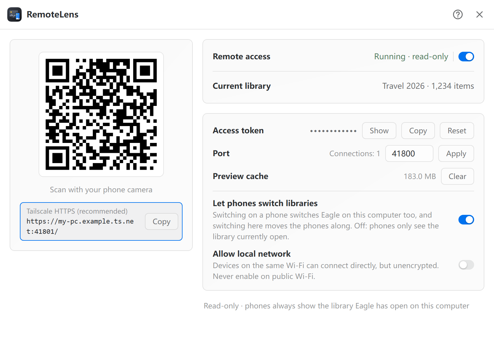

# RemoteLens

**English** | [中文](README_zh.md)

Browse your [Eagle](https://eagle.cool) library from your phone — anywhere, read-only, without copying the library to the phone.

Eagle has no mobile app. RemoteLens is an Eagle plugin that serves the library open in Eagle as a mobile web page. Scan a QR code and you are in.



## What you need

- Eagle 4 on Windows or macOS, running on a computer that stays on
- [Tailscale](https://tailscale.com) on that computer **and** on your phone, signed in to the same account (free for personal use)

Tailscale is a private network between your own devices. With it on both ends, the phone reaches the computer from any network — home Wi-Fi, mobile data, a café — and nobody else can. No port forwarding, no public address, no cloud storage: pictures travel from your computer straight to your phone, encrypted.

## Set up

**1. Install Tailscale on the computer**

Download it from [tailscale.com/download](https://tailscale.com/download), install, and sign in (Google, Microsoft, Apple or GitHub account).

**2. Install Tailscale on the phone**

Get it from the App Store or Google Play and sign in with **the same account**. Switch it on; it can stay on.

**3. Install the plugin**

Download or clone this repository. In Eagle: **Plugins → Developer options → Import local project**, and choose the inner `RemoteLens` folder — the one that contains `manifest.json`.

**4. Turn it on and scan**

Open the plugin, turn on **Remote access**, and scan the QR code with your phone camera. That's it. Add the page to your home screen to open it like an app next time.

If something is missing, the plugin window tells you which step is left and has a **Check again** button.

### Optional: the https address

Out of the box the plugin gives you an address like `http://100.x.y.z:41800`. It is already private and encrypted by Tailscale. To get a nicer `https://your-pc.your-tailnet.ts.net:41801` address, open the [Tailscale admin console](https://login.tailscale.com/admin/dns), go to **DNS**, enable **HTTPS Certificates**, then press **Check again** in the plugin.

## Using it

| | |
|---|---|
| **Browse** | Folder tree, tags and tag groups, uncategorized / untagged. Tap the menu button for the sidebar. |
| **Search** | Names, tags, notes, links and folder names. |
| **Sort and filter** | The ⇅ button: sort order, type, rating, shape, colour, format, and two layouts (squares, or justified rows that keep each picture's proportions as in Eagle). |
| **View** | Tap a picture. Swipe sideways for the next one, pinch or double-tap to zoom, swipe down to close. Videos play with seeking. The ⓘ button shows details and a download link. |
| **Slideshow** | The ▶ button in the viewer. |
| **Reading mode** | The book button: every picture of the current folder or search stitched into one seamless strip, vertical or horizontal in either direction. Made for comics and photo sequences. |
| **Switch library** | Tap the library name at the top of the sidebar. Eagle on the computer switches too, and switching in Eagle moves the phone along: both always show the same library. |

## Privacy

- **Read-only.** The plugin never modifies a library. The only thing a phone can change is which library Eagle has open.
- **Only Eagle libraries.** Nothing else on the computer is reachable.
- **Off means off.** With the switch off, no port is open.
- **Two locks.** A device must be in your Tailscale network *and* have the access token (the QR code carries it). Requests from the public internet are refused before the token is even looked at. **Reset** in the plugin window signs every device out.
- **What you hid stays hidden.** Items in the trash and anything inside a password-protected folder are never served.

## Good to know

- The plugin is a background service: closing its window does not stop it, the switch does.
- **After updating the plugin, quit Eagle completely and open it again.** The phone page tells you when this is needed.
- Speed depends on the computer's upload bandwidth. Large pictures are downsized on the fly and cached, so the phone does not pull multi-megabyte originals. On the same Wi-Fi the two devices connect directly.
- The first time a very large library is opened it takes a few seconds to index; after that it is instant.
- Settings and caches live in `~/.remotelens/`. Nothing is written into a library.
- Not included: editing, smart folders, similar-image and semantic search.

## Troubleshooting

| Problem | Fix |
|---|---|
| The plugin does not appear after importing | You picked the outer folder. Import the inner `RemoteLens` folder, the one with `manifest.json`. It is listed under **Service**. |
| The phone cannot open the page | Check that Tailscale is on and connected on both devices, with the same account. |
| "The plugin was updated but Eagle has not been restarted" | Quit Eagle completely (also from the system tray) and open it again. |
| "Library unavailable" | The switch is off, or the drive holding the library is not connected. |
| The port is in use | Change the port in the plugin window and press **Apply**. |
| It is slow away from home | Some networks force Tailscale to relay traffic. Run `tailscale ping <phone-name>` on the computer: `via DERP` means relayed. |

## For developers

The server is plain Node with no dependencies and runs without Eagle:

```bash
node tools/dev-server.js "/path/to/My.library" 41800   # prints a login URL, binds 127.0.0.1
npm test                                                # node:test, nothing to install
```

```
RemoteLens/            the plugin (import this folder into Eagle)
  manifest.json
  index.html, styles.css, js/   plugin window: switch, QR code, settings
  server/                       HTTP server, library index, auth, Tailscale glue
  web/                          the mobile web app (no build step)
tests/                 node:test suites with a generated fixture library
tools/dev-server.js    run the server standalone
```

The web files are read from disk on every request, so changes to `web/` only need a page reload. Changes to `server/` or `js/` need Eagle restarted.

## Credits

QR codes are generated with [qrcode-generator](https://github.com/kazuhikoarase/qrcode-generator) by Kazuhiko Arase (MIT).

RemoteLens is an independent project and is not affiliated with Eagle or Tailscale.

## License

[MIT](LICENSE)
