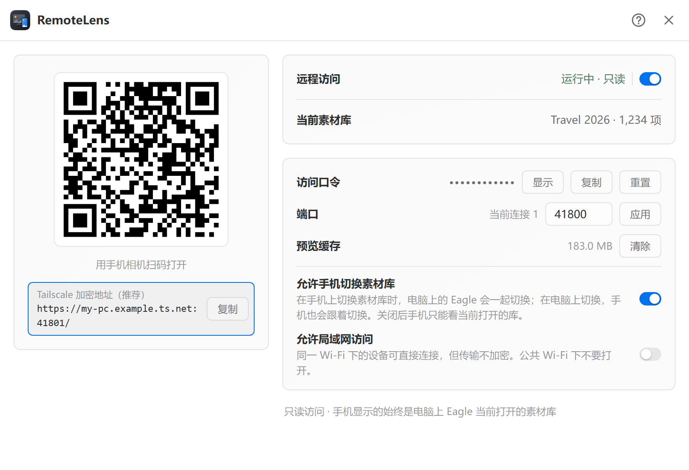

# RemoteLens

[English](README.md) | **中文**

用手机浏览你的 [Eagle](https://eagle.cool) 素材库：随时随地、只读、不需要把素材库拷到手机上。

Eagle 没有手机端。RemoteLens 是一个 Eagle 插件，把 Eagle 当前打开的素材库做成一个手机网页，扫一下二维码就能用。



## 需要准备什么

- Windows 或 macOS 上的 Eagle 4，电脑保持开机、Eagle 保持运行
- 电脑**和**手机上都装好 [Tailscale](https://tailscale.com)，登录同一个账号（个人使用免费）

Tailscale 是只连接你自己设备的私有网络。两头都装上之后，手机在任何网络下（家里 Wi-Fi、手机流量、咖啡店）都能连到电脑，而别人连不上。不需要端口映射，不需要公网地址，也不经过任何云存储：图片从你的电脑直接传到你的手机，全程加密。

## 安装步骤

**1. 在电脑上安装 Tailscale**

到 [tailscale.com/download](https://tailscale.com/download) 下载安装，然后登录（可以用 Google、Microsoft、Apple 或 GitHub 账号）。

**2. 在手机上安装 Tailscale**

在 App Store 或 Google Play 下载，用**同一个账号**登录并打开连接。之后可以一直开着。

**3. 安装插件**

下载或克隆本仓库。在 Eagle 中：**插件 → 开发者选项 → 导入本地项目**，选择里层的 `RemoteLens` 文件夹，也就是包含 `manifest.json` 的那个。

**4. 打开开关，扫码**

打开插件，打开**远程访问**开关，用手机相机扫描二维码，就可以用了。在手机浏览器里把网页添加到主屏幕，下次就能像 App 一样直接打开。

如果还差哪一步，插件窗口会直接告诉你，并提供**重新检测**按钮。

### 可选：使用 https 地址

默认情况下插件给出的是 `http://100.x.y.z:41800` 这样的地址，它已经是私有的，并由 Tailscale 加密。如果想要更好看的 `https://你的电脑名.你的网络名.ts.net:41801`，打开 [Tailscale 管理后台](https://login.tailscale.com/admin/dns)，进入 **DNS** 页，开启 **HTTPS Certificates**，再回到插件里点**重新检测**。

## 怎么用

| | |
|---|---|
| **浏览** | 文件夹树、标签与标签分组、未分类 / 未标签。点左上角菜单按钮打开侧栏。 |
| **搜索** | 名称、标签、备注、链接、文件夹名。 |
| **排序和筛选** | 右上角 ⇅ 按钮：排序方式、类型、评分、形状、颜色、格式，以及两种布局（方格，或像 Eagle 那样保持图片比例的自适应布局）。 |
| **看图** | 点一张图进入。左右滑动切换，双指或双击缩放，下滑关闭。视频可拖动进度播放。ⓘ 按钮查看详细信息和下载原文件。 |
| **幻灯片** | 看图时顶部的 ▶ 按钮。 |
| **阅读模式** | 书本按钮：把当前文件夹或搜索结果里的图片无缝拼成一条，竖向或横向（两个方向）连续阅读。适合漫画和成组照片。 |
| **切换素材库** | 点侧栏顶部的素材库名称。电脑上的 Eagle 会一起切换；在 Eagle 里切换，手机也会跟着切换，两边显示的始终是同一个库。 |

## 隐私

- **只读。** 插件不会改动任何素材库。手机唯一能改变的，是 Eagle 当前打开哪个素材库。
- **只涉及 Eagle 素材库。** 电脑上的其他内容访问不到。
- **关了就是关了。** 开关关闭时不开放任何端口。
- **两道锁。** 设备必须在你的 Tailscale 网络里，**并且**持有访问口令（二维码里已带上）。来自公网的请求在校验口令之前就会被拒绝。在插件窗口点**重置**，所有设备都会退出登录。
- **你隐藏的内容保持隐藏。** 回收站里的内容、带密码的文件夹里的内容一律不提供。

## 使用须知

- 插件是后台服务：关掉它的窗口不会停止服务，关开关才会。
- **更新插件后，要完全退出 Eagle 再重新打开。** 需要这样做时，手机网页上会有提示。
- 速度取决于电脑所在网络的上行带宽。大图会按需缩小并缓存，手机不必拉取几 MB 的原图。在同一个 Wi-Fi 下两台设备会直连。
- 很大的素材库第一次打开需要几秒到十几秒建立索引，之后就是即时的。
- 设置和缓存保存在 `~/.remotelens/`，不会往素材库里写任何东西。
- 不包含：编辑、智能文件夹、以图找图、语义搜索。

## 常见问题

| 问题 | 解决办法 |
|---|---|
| 导入后插件没有出现 | 选成了外层文件夹。请导入里层的 `RemoteLens` 文件夹（有 `manifest.json` 的那个）。它显示在**服务**分类下。 |
| 手机打不开网页 | 确认电脑和手机上的 Tailscale 都已打开并连接，且是同一个账号。 |
| 提示「插件已更新，但电脑上的 Eagle 还没重启」 | 完全退出 Eagle（包括系统托盘里的图标）再打开。 |
| 提示「素材库暂时不可用」 | 开关被关掉了，或者素材库所在的磁盘没有连接。 |
| 端口被占用 | 在插件窗口里换一个端口，点**应用**。 |
| 在外面用很慢 | 有些网络会让 Tailscale 改走中继。在电脑上运行 `tailscale ping <手机名>`，结果里带 `via DERP` 就是中继。 |

## 开发

服务端是不带依赖的纯 Node 代码，可以脱离 Eagle 运行：

```bash
node tools/dev-server.js "/path/to/My.library" 41800   # 打印登录地址，只监听 127.0.0.1
npm test                                                # node:test，无需安装依赖
```

```
RemoteLens/            插件本体（导入 Eagle 时选这个文件夹）
  manifest.json
  index.html, styles.css, js/   插件窗口：开关、二维码、设置
  server/                       HTTP 服务、素材库索引、口令校验、Tailscale 对接
  web/                          手机网页端（无构建步骤）
tests/                 node:test 测试，使用生成的示例素材库
tools/dev-server.js    脱离 Eagle 单独运行服务
```

网页文件每次请求都从磁盘读取，所以改 `web/` 只需要刷新页面；改 `server/` 或 `js/` 需要重启 Eagle。

## 致谢

二维码由 Kazuhiko Arase 的 [qrcode-generator](https://github.com/kazuhikoarase/qrcode-generator)（MIT）生成。

RemoteLens 是独立项目，与 Eagle、Tailscale 官方均无关。

## 许可证

[MIT](LICENSE)
